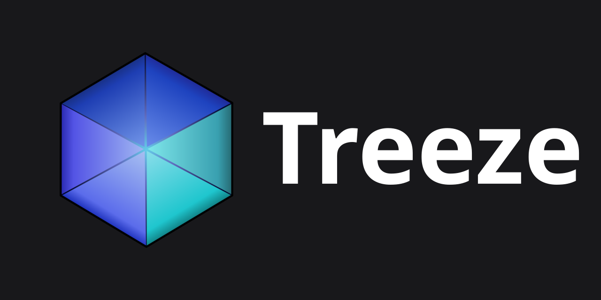

<p align="center">
  
</p>

# Treeze

Treeze is a Python-first UI framework for building interactive applications that run in a web browser. It uses a desktop-style widget API: define windows, layouts, and event handlers in Python, and let Treeze handle the browser side.

I started Treeze as a personal project to experiment with building web interfaces without having to write a separate frontend for every application.

## Getting started

Requires Python 3.11 or newer.

```bash
git clone https://github.com/mikesided/treeze.git
cd treeze
python -m pip install -e .
```

Create `counter.py`:

```python
from treeze.core import App
from treeze.widgets import Button, Label, VLayout, Window


class CounterWindow(Window):
    def __init__(self):
        super().__init__()
        self.count = 0
        self.layout = VLayout(spacing=12, padding=20)

        self.label = Label('Clicks: 0', parent=self.layout)
        button = Button('Increment', parent=self.layout)
        button.clicked.connect(self.increment)

    def increment(self):
        self.count += 1
        self.label.text = f'Clicks: {self.count}'


app = App(window=CounterWindow)

if __name__ == '__main__':
    app.run()
```

Run `python counter.py`, then open http://127.0.0.1:8000.

For more examples, see [`examples/showcase.py`](examples/showcase.py). Note that the showcase file is not entirely up to date.

## How it works

Each browser session has its own Python widget tree. Browser events travel over WebSockets and trigger Python signals and callbacks. When widget state changes, Treeze tracks the affected widgets and sends incremental patches instead of rebuilding the entire interface.

The backend runs on FastAPI and ASGI. Treeze also includes layouts, styling and theme support, asynchronous widget initialization, and a network simulator for testing latency, jitter, and packet loss.

## Status

Treeze is currently a one-person project and is still under development. The API may change.

## License

[MIT](LICENSE)